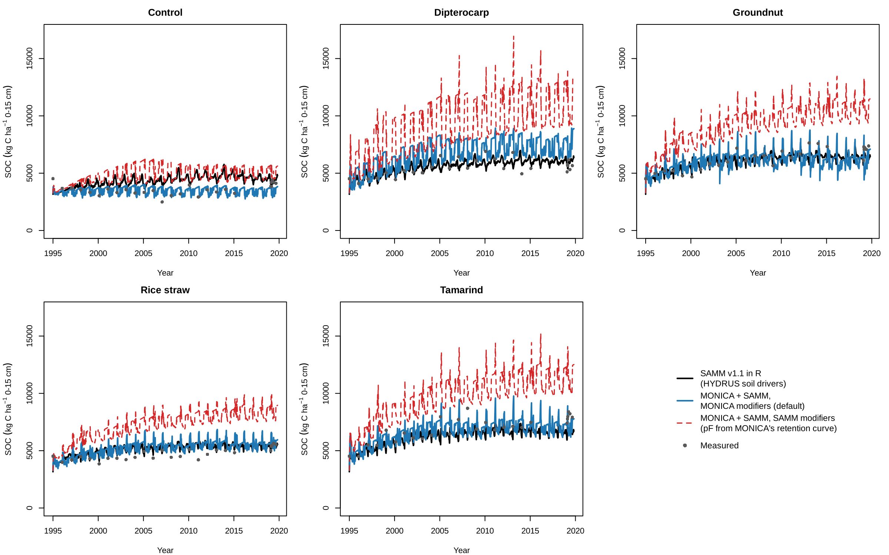
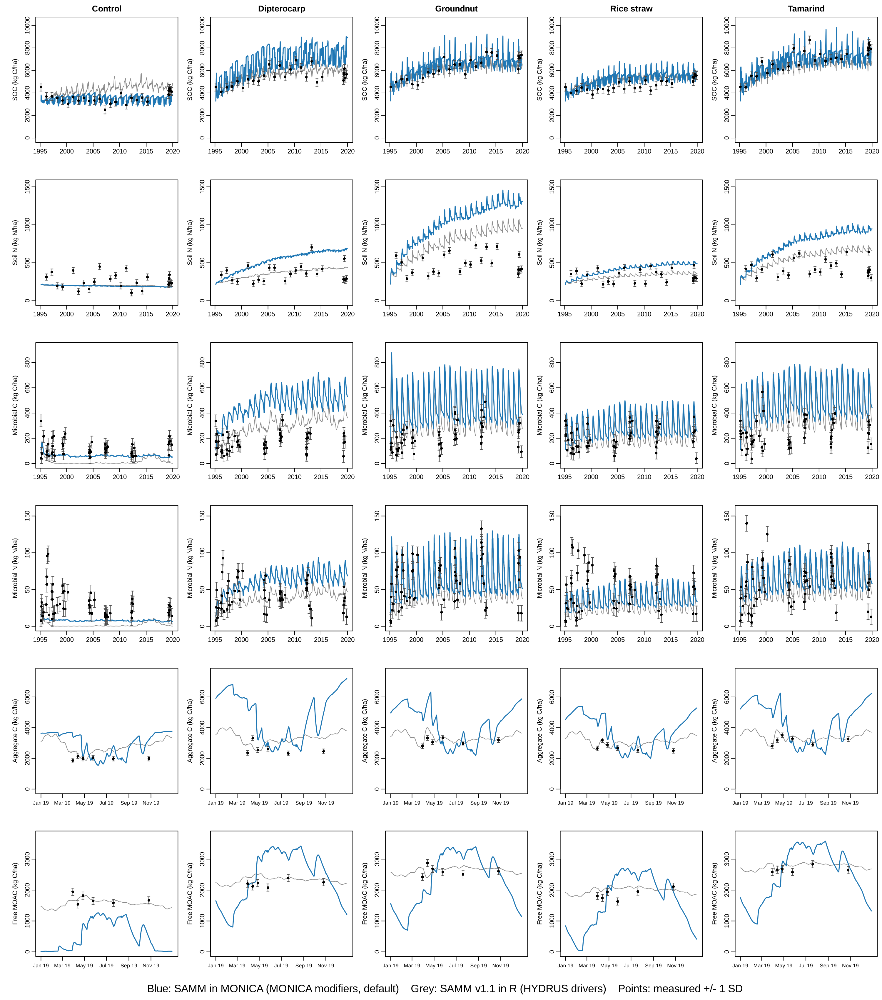
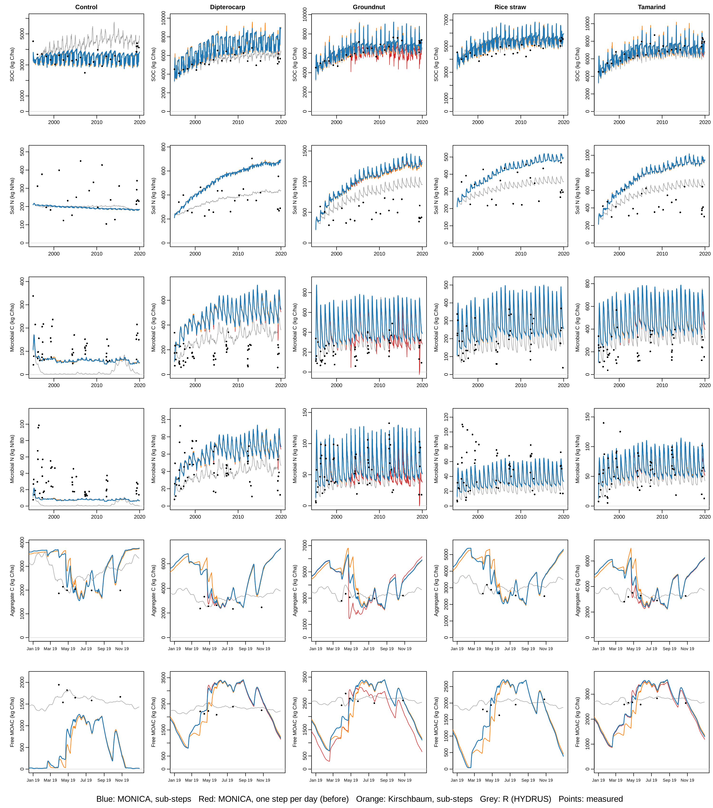
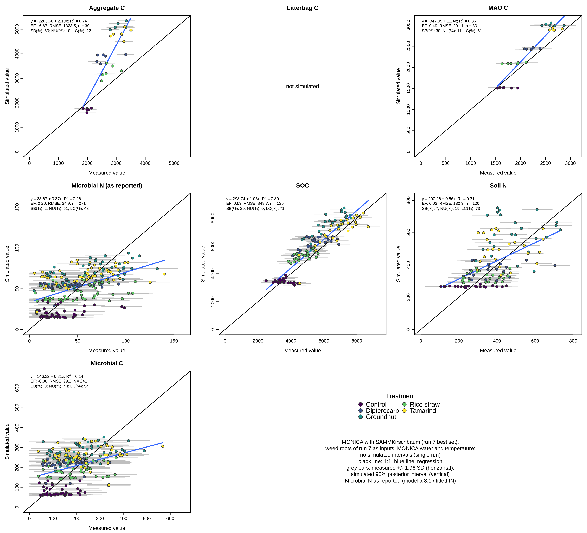

# SAMM in MONICA

Known issues and their status: [samm-issues.md](samm-issues.md).

This document describes how the soil organic matter model **SAMM** (Soil Aggregation through Microbial
Mediation) was added to MONICA as an alternative to the DAISY-based soil organic matter module, and every
change this required. Branch: `samm-som-module` (based on release `3.7.4.laub-som-flow`).

- Model: Laub, M., Blagodatsky, S., Van de Broek, M., Schlichenmaier, S., Kunlanit, B., Six, J., Vityakon, P.,
  Cadisch, G. (2024): SAMM version 1.0: a numerical model for microbial-mediated soil aggregate formation.
  Geosci. Model Dev. 17, 931-956, https://doi.org/10.5194/gmd-17-931-2024, and its corrigendum (2025)
  with the corrected `MAO_C_max` equation and the recalibrated parameters (SAMM v1.1).
- Reference code: SAMM v1.1 in R (https://doi.org/10.5281/zenodo.15648425), copied to `tests/samm/data/Samm_main.R`.
- Mineral N coupling and MAOM desorption: "scenario D" of the SAMM ecosystem-model development in R
  (`Samm3H_functionsMinN.R`).

DAISY stays the default. With `"SOM_Model": "DAISY"` (or no key) all results are bit-identical to MONICA
3.7.4 / 3.7.4.laub-som-flow (checked with all 66 simulations of `tests/suites.toml`).

---

## 1. Using SAMM

In the soil organic parameters (`general/soil-organic.json`, or the site's `SoilOrganicParameters`):

```json
"SoilOrganicParameters": {
  "=": ["include-from-file", "general/soil-organic.json"],
  "SOM_Model": "SAMM",
  "SAMM": { }
}
```

An empty `"SAMM"` object uses all defaults (section 6). Everything else in `soil-organic.json` stays as it is:
urea hydrolysis, NH3 volatilisation, nitrification, denitrification and N2O are MONICA's and are used with
SAMM unchanged. Only the turnover of organic matter (DAISY's AOM, SMB and SOM pools) is replaced.

Check that SAMM is active: the outputs `SAMM_*` (section 8) are non-zero, the DAISY outputs `SOMs`, `SOMf`,
`SMBs`, `SMBf`, `AOMs`, `AOMf` are zero.

---

## 2. The SAMM model

### Pools (per soil layer, kg ha⁻¹ of the layer)

| Pool | Content |
|---|---|
| `STR_C` | structural litter C: lignin + polyphenols, carbon only |
| `LAB_C`, `LAB_N` | labile (metabolic) litter, all litter N |
| `LMW_C`, `LMW_N` | low molecular weight (dissolved) C and N, the only substrate microbes take up; moves with water |
| `MIC_C`, `MIC_N` | microbial biomass |
| `MAO_C`, `MAO_N` | mineral-associated organic matter |
| `AggSTR_C`, `AggLAB_C`, `AggLAB_N`, `AggMAO_C`, `AggMAO_N` | the same pools protected in aggregates (not decomposed) |

### Flows (equations A12-A53 of the paper; see `src/core/samm.cpp`)

- Litter depolymerisation to LMW with reverse Michaelis-Menten kinetics, `k · pool · a_MIC · corr_F`, where
  `a_MIC = max(MIC_C / (K_M_MIC_C + MIC_C), 0.05)`; the fraction `1 − CUE` of depolymerised STR and LAB is respired.
  Part of LAB is protected by STR: `p_LAB = min(1, STR_C · pc_STR_LAB / LAB_C)`.
- Microbial uptake of LMW (`mu_max`) with a C:N-dependent carbon use efficiency
  `CUE_LMW · min(1, 13.4 · LMW_N / LMW_C)`; maintenance respiration `m_MIC`; death `k_MIC` with the fraction
  `f_MICMAOM` to MAO and the rest back to LMW.
- MAO: sorption of LMW `K_LMW_MAO · LMW_C · (MAO_C_max − MAO_C) / MAO_C_max`, decomposition `k_MAO · a_MIC`,
  and desorption (scenario D, COMISSION form) `k_des · soil mass · MAO_C / MAO_C_max`.
  `MAO_C_max = depth · 10 000 m² · bulk density · (silt + clay) · c_SORP` (corrected equation of the corrigendum).
- Aggregates form with microbial growth plus a constant physicochemical formation:
  `STR → AggSTR = min((LMW→MIC + NonMicAgg) · aggfactSTR_C, STR_C)`, LAB follows with `pc_STR_LAB`,
  `MAO → AggMAO = min((LMW→MIC + NonMicAgg) · aggfactMAO_C, MAO_C)`; aggregates break down with `kAgg · corr_F`.
- Microbial N: release when MIC C:N < `MicMinCN`, immobilisation from LMW-N when MIC C:N > `MicMaxCN`.
- **Mineral N (scenario D)**: microbes take N only from LMW-N. Gross mineralisation to mineral N is
  `f_min · (N release + negative immobilisation) + f_turn · (MIC-N and MAO-N turnover to LMW-N)`.
  Optional immobilisation of mineral N (`min_imm_frac`, `min_imm_k`) is off by default, as in scenario D.

All decomposition, death, maintenance, sorption, desorption and aggregate breakdown rates are multiplied by the
rate modifier `corr_F` (temperature × moisture, section 4.3).

### Numerics

Classical 4th-order Runge-Kutta for all organic layers together (layers are coupled by the transport of LMW).
Normally one step per day, exactly as `deSolve::rk4` with daily times in the R code. On days with very fast
turnover (hot and wet, large inputs) one daily step is unstable, so the day is split adaptively into n equal
steps (section 4.1, `maxTurnoverPerStep`); the day's drivers are kept constant. With the HYDRUS drivers of the
paper this never happens, so the R results are reproduced exactly. Fluxes (CO2, leaching, gross
mineralisation) are integrated with the same Runge-Kutta weights, so the daily C and N balances close to
rounding error (about 1e-12 kg ha⁻¹; checked every day, `debug()` message if a residual exceeds 1e-6).

---

## 3. Overview of the changed files

| File | Change |
|---|---|
| `src/core/samm.h`, `src/core/samm.cpp` | **new**: SAMM core without MONICA dependencies (pools, parameters, derivatives, RK4 step, transport, balance check) |
| `src/core/samm-litter-chemistry.h/.cpp` | **new**: built-in lignin/polyphenol table (the .cpp is generated) |
| `data/samm/litter-chemistry.csv`, `generate_litter_chemistry.py`, `README.md` | **new**: chemistry values with sources, generator |
| `src/core/soilorganic.h/.cpp` | SAMM branch: initialisation, spin-up, daily step, inputs, tillage, getters |
| `src/core/monica-parameters.h/.cpp` | `SOM_Model`, `SAMMSettings` (JSON object `"SAMM"`), chemistry fields of organic matter parameters and their table lookup |
| `src/core/crop-module.h/.cpp` | organic matter callback tells whether the input are dead roots |
| `src/core/monica-model.cpp` | passes the site latitude to SAMM, calls SAMM's tillage, forwards the root flag |
| `src/io/build-output.cpp` | new outputs `SAMM_*` and `pF` (appended; existing output ids unchanged) |
| `CMakeLists.txt` | new source files |
| `tests/samm/` | **new**: tests against the R model and the Khon Kaen set-up for MONICA |
| `documentation/samm.md`, `documentation/images/samm_khonkaen_soc.png` | this document |

---

## 4. Changes in detail

### 4.1 SAMM core (`src/core/samm.h`, `samm.cpp`)

- `samm::Params`: all SAMM parameters with the names of the R code. `Params::samm_v11()` is corrigendum
  Table 4, column SAMM (default); `Params::sammNoAgg_v11()` column SAMMnoAgg (`kAgg = 1`, aggregate formation
  0). Scenario D additions: `f_min = 0.5`, `f_turn = 0.10`, `min_imm_frac = 0`, `min_imm_k = 0`,
  `k_des = 0.006` kg C t⁻¹ soil d⁻¹ (the values of `run_scenarioD.R`). `withoutMineralN()` switches them off
  (pure SAMM v1.1). `Params::samm_kirschbaum()`: the recalibration for the Kirschbaum temperature function ×
  MONICA's moisture function without scaling (highest-likelihood set of DREAM run 7 against all Khon Kaen data,
  `tests/samm/calibration/results/dream7`): density-dependent microbial death (`betaMIC` 1.967), mineral N
  release `f_min` 0.66 and `f_turn` 0.86, no immobilisation of mineral N and no desorption (section 7.5).
- `samm::LayerEnv`: thickness, bulk density, silt + clay and a layer-specific `c_SORP`; `maoCmax()`.
- **Layer thickness**: SAMM was calibrated for one 0-15 cm layer. `K_M_MIC_C` (kg C ha⁻¹) and `NonMicAgg`
  (kg C ha⁻¹ d⁻¹) are amounts per layer, so they are scaled by `thickness / refDepth` (`refDepth = 0.15` m);
  this keeps them the same per soil volume. `MAO_C_max` and desorption already contain the layer depth.
- `Profile::derivatives()`: the flows of section 2 for each layer, then the signed transport of LMW-C and
  LMW-N across each layer's lower boundary (`LayerSoluteTransport` of the R code: donor layer by flux
  direction, at most 95% of the donor pool per day, inflow from below the bottom layer with a concentration of
  0 by default).
- `Profile::stepRK4()`: one RK4 step of `dt` days (default 1); drivers are either constant over the day
  (MONICA) or a function of the stage time (used by the test harness to reproduce deSolve, whose 4th stage reads
  the next day's drivers). All flows stay rates per day, including the per-day limits of the R code
  (formation ≤ source pool, leaching ≤ 95%, immobilisation ≤ half of LMW-N), so smaller steps solve the same
  equations more accurately; with `dt = 1` the step is bit-identical to before.
- `Profile::stepAdaptive()` (used by MONICA): n = ⌈largest relative net loss of any pool per day at the start
  of the day / `maxTurnoverPerStep`⌉ steps of 1/n day (at most `maxSubsteps`); if an RK4 stage or the result
  would make a pool negative, the day is redone with twice as many steps. `maxTurnoverPerStep = 0` gives one step
  per day.
- Safety net in the flows: the carbon use efficiency of LMW is 0 if LMW-C or LMW-N is ≤ 0, and aggregate
  formation is never negative. Both only act on negative (RK4 stage) states; the R code has no lower limits, and
  a negative LMW-N in an RK4 stage made the CUE strongly negative there, so that microbes and aggregates were
  "un-grown" (section 7.3, numerical stability).
- `balanceResidual()`, `totalC()`, `totalN()`, `socC()`.

### 4.2 Switching between DAISY and SAMM (`soilorganic.cpp`)

- Constructor: with `SOM_Model == "SAMM"` the DAISY initialisation is skipped and `initSAMM()` runs. An unknown
  value prints a warning and uses DAISY.
- `step()`: `fo_SAMM()` replaces `fo_MIT()`; `fo_PoolUpdate()` is skipped. `fo_Urea()`, `fo_Volatilisation()`,
  nitrification, denitrification and N2O are called as before.
- DAISY's code paths are unchanged, which is why DAISY results stay bit-identical.

### 4.3 Daily step `fo_SAMM()`

Drivers per organic layer, taken from MONICA after its soil temperature and moisture steps of the same day:

| SAMM driver | from MONICA |
|---|---|
| `corr_F` | temperature and moisture modifiers, see below |
| soil water [kg ha⁻¹] | `θ · thickness · 10⁷` |
| water flux across the lower boundary of layer i [mm d⁻¹] | `vs_SoilWaterFlux` of layer i+1 (as SoilTransport uses it), or the flux at the profile's lower boundary |
| mineral N available for immobilisation | NH4 + NO3 of the layer |

**Rate modifiers** (`"rateModifiers"`):

- `"MONICA"` (default): the same temperature and moisture functions as DAISY (`fo_TempOnDecompostion_kaiteew`
  and `fo_MoistOnDecompostion_kaiteew`, or the older functions if the `__enable_kaiteew_*__` switches are off),
  multiplied by `rateScaleMONICA = 0.545`. This factor makes the mean effective rates equal to those with SAMM's
  own functions over the 9070 days of the Khon Kaen drivers of the SAMM paper (soil temperature at 7.5 cm, water
  content and pF from HYDRUS): mean SAMM modifier 1.942, mean MONICA modifier 3.560 (Q10 3.15, optimum 38.2 °C,
  moisture optimum 45% of saturation, MONICA's saturation of that sandy soil 0.468). It is valid for the
  kaiteew functions with the values in `general/soil-organic.json`.
- `"SAMM"`: the functions of the paper, `2^((T − 20)/10)` and the pF scalar, with MONICA's soil temperature and
  pF (from MONICA's van Genuchten-Vereecken retention curve).
- `"Kirschbaum"`: the temperature function of Kirschbaum (1995, Soil Biol. Biochem. 27, 753-760),
  `exp(−3.764 + 0.204·T·(1 − T/73.8))` (maximum 1 at 36.9 °C, flattening above 30 °C), with MONICA's moisture
  function `exp(−18 (θ/θ_sat − MoistureDecOptimal)²)` (always the kaiteew function), without scaling, so that
  `mu_max` and the other rates are the true maxima. Below 25 °C it is almost the same as MONICA's temperature
  function, above 30 °C much flatter. Only meaningful with the parameter set calibrated for it,
  `"variant": "SAMMKirschbaum"`, which sets this option. (Until this version the v1.1 parameters were used with a
  factor `rateScaleKirschbaum = 4.90`, which pushed the effective `mu_max` above 1; removed.)

After the step:

- gross mineralisation is added to NH4; immobilisation of mineral N (if enabled) is taken from NH4, then NO3,
  never more than is there;
- CO2 per layer goes to `vo_SMB_CO2EvolutionRate` (kg C m⁻³ d⁻¹), which MONICA's denitrification uses as before,
  and to `get_DecomposerRespiration()` (NEE, NEP, `Rh`);
- `get_NetNMineralisationRate()` = gross mineralisation − immobilisation (kg N m⁻²). DAISY reports the absolute
  value of its N balance; SAMM reports the signed net value;
- the layer's soil organic carbon (`SOC` outputs, `vs_SoilOrganicCarbon`) is set to
  `LMW + MIC + MAO + AggSTR + AggLAB + AggMAO`, i.e. all SAMM C except free litter STR and LAB (the counterpart
  of DAISY, whose SOC excludes the added organic matter pools). This follows the SOC definition of the paper's
  Fig. 7, plus the small LMW pool.

### 4.4 Initialisation (`initSAMM()`, `spinupSAMM()`)

- Organic layers: the same as for DAISY, down to `MaxMineralisationDepth` (default 0.4 m).
- Each layer's measured SOC (kg C ha⁻¹) is split with fixed fractions (defaults from the earlier R work):
  `LMW 0.5%`, `MIC 2%`, aggregate litter `10%` (10% of it STR), MAO + AggMAO the rest (60% of it free).
  Free litter is added on top: `3%` of SOC (16% of it STR), so the SOC output on day 0 equals the measurement.
  N: MAO and AggMAO with C:N 9 (`init_CN_MAO`, ≤ 0 takes the layer's soil C:N), MIC 10, LMW 20, litter 142.9.
- There is no inert pool (DAISY's Falloon inert share is not used with SAMM).
- Optional spin-up (`"spinup": true`): each layer is run without transport with a constant rate modifier
  (`spinup_CorrF`, default 0.5) and a constant input (`spinup_InputC` kg C ha⁻¹ yr⁻¹ over the organic layers,
  distributed by the layers' measured SOC, C:N `spinup_InputCN`, structural share `spinup_InputSTR`) until the
  total C changes by less than 0.001% per year (at most `spinup_MaxYears`), then all pools are scaled to the
  measured SOC.
- `c_SORP`: `"cSorp"` if given; else from the clay mineralogy, `(kaolinite · 0.049 + (mica + oxides) · 0.085) /
  (kaolinite + mica + oxides)` (Georgiou et al. 2025, as in the earlier R work); else from the site's latitude:
  0.049 (1:1 clays) within the tropics (|latitude| ≤ 23.44°), 0.083 (2:1 clays) elsewhere, 0.066 if the latitude
  is not valid. MONICA passes the site latitude in `MonicaModel`'s constructor (`withSiteLatitude()`).
- DAISY's pools are set to 0.

### 4.5 Organic inputs (`addOrganicMatterSAMM()`)

`addOrganicMatter()` got a fourth argument `isRootInput`. The crop module's organic matter callback now has the
signature `void(std::map<size_t, double>, double, bool)`; `fc_MoveDeadRootBiomassToSoil()` passes `true`,
cut residues `false`; the three callbacks in `monica-model.cpp` forward it. DAISY ignores the flag.

For each layer that receives material (`amount` kg FM ha⁻¹):

- urea, NH4 and NO3 contents go to the mineral pools exactly as with DAISY;
- C = C content (`CorgContent`, else 0.45) × dry matter;
- organic N: crop residues: dry matter × N concentration (from the crop model); organic fertilisers: as DAISY
  assigns it (AOM fast and slow via their C:N ratios, the rest via the soil C:N);
- structural C: `STR = min(1, (0.63 · lignin + 0.53 · polyphenols) / C content) · C`. Lignin and polyphenols are
  the root values for dead roots, else the shoot values (section 5). The carbon contents 0.63 and 0.53 reproduce
  the structural shares of the four Khon Kaen litters of the paper's R code;
- optional for organic fertilisers: `SAMM_ShareToLMW` and `SAMM_ShareToMAO` (default 0) send a share of C and N
  directly to LMW or MAO, to test the manure split;
- the rest of the C goes to LAB; all N goes with the non-structural C (LAB, and LMW/MAO if used);
- roots below the deepest organic layer are added to it (as MONICA's crop module already does).

Organic fertilisers also get a DAISY AOM record in the receiving layer, carrying the fertiliser's dry matter,
NH4 content and C amount, because MONICA's NH3 volatilisation (`fo_Volatilisation`, ALFAM) uses it. With SAMM
this record is not decomposed. Crop residues get no such record (DAISY creates one, but residue NH3 losses are
negligible).

### 4.6 Tillage (`SoilOrganic::applyTillage()`)

`MonicaModel::applyTillage()` now calls `_soilOrganic->applyTillage(depth)` after
`SoilColumn::applyTillage(depth)`. With SAMM, in the tilled organic layers a fraction
`tillageAggregateDestruction` (default 0.20, the `K` option of the earlier R work) of AggSTR, AggLAB and AggMAO
(C and N) is released to STR, LAB and MAO, then all SAMM pools of the tilled layers are averaged (mixed), as
SoilColumn does with DAISY's pools. With DAISY the call does nothing.

### 4.7 Parameters (`monica-parameters.h/.cpp`)

- `SoilOrganicModuleParameters`: `std::string somModel` (JSON `"SOM_Model"`) and `SAMMSettings samm`
  (JSON object `"SAMM"`); both are in `to_json()`.
- `SAMMSettings`: the settings of section 6, `merge()` (`"variant"` first selects the default parameter set,
  single parameters override it; parameters may be given directly in `"SAMM"` or in `"SAMM": {"params": {...}}`),
  `to_json()`, `effectiveCSorp()`.
- `OrganicMatterParameters`: `samm_Lignin`, `samm_Polyphenols`, `samm_RootLignin`, `samm_RootPolyphenols`
  (JSON `SAMM_Lignin` etc., kg kg⁻¹ DM, −1 = not given), `samm_ShareToLMW`, `samm_ShareToMAO`, and
  `fillSAMMChemistryFromTable()`. `CropResidueParameters` fills missing values from the table by `species`,
  `OrganicFertilizerParameters` by `id`, both in `merge()` and `deserialize()`; materials not in the table get the
  default rows.

### 4.8 Outputs (`build-output.cpp`)

Appended after the last existing output, so existing output ids do not change:

| Output | Unit | Content |
|---|---|---|
| `SAMM_STR_C`, `SAMM_LAB_C`, `SAMM_LMW_C`, `SAMM_MIC_C`, `SAMM_MAO_C`, `SAMM_AggSTR_C`, `SAMM_AggLAB_C`, `SAMM_AggMAO_C` | kg C m⁻³ (per layer) | SAMM C pools |
| `SAMM_LAB_N`, `SAMM_LMW_N`, `SAMM_MIC_N`, `SAMM_MAO_N`, `SAMM_AggLAB_N`, `SAMM_AggMAO_N` | kg N m⁻³ (per layer) | SAMM N pools |
| `SAMM_CO2` | kg C m⁻³ d⁻¹ (per layer) | heterotrophic respiration |
| `SAMM_MinGross` | kg N m⁻³ d⁻¹ (per layer) | gross mineralisation LMW-N → NH4 |
| `SAMM_LeachC`, `SAMM_LeachN` | kg ha⁻¹ d⁻¹ | LMW moved below the deepest organic layer |
| `pF` | – (per layer) | MONICA's soil water tension |
| `SAMM_Substeps` | – | number of RK4 steps SAMM used on the day (1 on almost all days) |

Per-layer pools in kg ha⁻¹ = value × layer thickness (m) × 10 000.

---

## 5. Litter chemistry

`data/samm/litter-chemistry.csv` gives lignin and polyphenols of all 64 crop residue species and 24 organic
fertilisers in `monica-parameters`, with separate root values for every crop. Sources, the basis of each value
(measured, with source, plant part, stage and n, or a documented estimate) and caveats are in
`data/samm/README.md`. In short: shoots from the European crop residue dataset of Thiébeau et al. (2021),
roots from Redin et al. (2014) and Thiébeau et al. (2021), manures and composts from the EOM4SOIL database.
Values in a material's JSON file override the table.

---

## 6. Parameter reference (`"SAMM": {...}`)

| Key | Default | Meaning |
|---|---|---|
| `variant` | `"SAMM"` | `"SAMM"` or `"SAMMnoAgg"` (parameter set of corrigendum Table 4), `"SAMMKirschbaum"` (recalibration, section 7.5; also sets `rateModifiers` `"Kirschbaum"`) |
| `k_STR`, `k_LAB`, `k_MIC`, `k_MAO`, `mu_max`, `kAgg` | 0.0031, 0.0366, 0.007, 0.00041, 0.337, 0.0323 | rates [d⁻¹] at `corr_F` = 1 |
| `K_M_MIC_C` | 66.8 | half saturation of `a_MIC` [kg C ha⁻¹ per `refDepth`] |
| `m_MIC`, `K_LMW_MAO` | 0.00064, 0.018 | maintenance, sorption rate [d⁻¹] |
| `CUE_STR`, `CUE_LAB`, `CUE_LMW` | 0.57, 0.51, 0.6 | carbon use efficiencies |
| `MicMinCN`, `MicMaxCN`, `f_MICMAOM`, `pc_STR_LAB` | 5.72, 7.77, 0.21, 2.54 | |
| `aggfactSTR_C`, `aggfactMAO_C`, `NonMicAgg` | 1.16, 1.57, 32.5 | aggregate formation |
| `c_SORP` | 0.049 | used only if no site value results from `cSorp`, mineralogy or latitude (it always does) |
| `refDepth`, `a_MIC_min`, `leachCap` | 0.15, 0.05, 0.95 | |
| `maxTurnoverPerStep`, `maxSubsteps` | 1.0, 64 | adaptive sub-steps (section 4.1); 0 = one step per day as in the R code |
| `f_min`, `f_turn`, `min_imm_frac`, `min_imm_k`, `k_des` | 0.5, 0.10, 0, 0, 0.006 | mineral N coupling and desorption (scenario D) |
| `rateModifiers`, `rateScaleMONICA` | `"MONICA"`, 0.545 | section 4.3 (`"MONICA"`, `"SAMM"` or `"Kirschbaum"`) |
| `tillageAggregateDestruction` | 0.20 | section 4.6 |
| `init_fLMW`, `init_fMIC`, `init_fAggLitter`, `init_AggLitterSTR`, `init_fMAOfree`, `init_freeLitter`, `init_freeLitterSTR` | 0.005, 0.02, 0.10, 0.10, 0.60, 0.03, 0.16 | section 4.4 |
| `init_CN_MAO`, `init_CN_MIC`, `init_CN_LMW`, `init_CN_Litter` | 9, 10, 20, 142.9 | |
| `spinup`, `spinup_InputC`, `spinup_InputCN`, `spinup_InputSTR`, `spinup_CorrF`, `spinup_MaxYears` | false, 2000, 50, 0.15, 0.5, 5000 | |
| `cSorp`, `clayKaolinite`, `clayMicaOxides` | −1 | explicit c_SORP or clay mineralogy shares (−1 = not given) |
| `cSorpKaolinite`, `cSorpMicaOxides`, `cSorp1to1`, `cSorp2to1` | 0.049, 0.085, 0.049, 0.083 | |
| `dailyLitterC`, `dailyLitterCN`, `dailyLitterSTR` | 0, 142.9, 0.16 | constant root input of the paper (weeds); 0 = off |
| `deepConcC`, `deepConcN` | 0 | LMW concentration of water rising from below the organic layers [kg kg⁻¹] |

---

## 7. Validation

### 7.1 C++ core against SAMM v1.1 in R

`tests/samm/khonkaen_forced.cpp` runs the C++ core with the set-up of the R code (one 0-15 cm layer, the
HYDRUS soil drivers of `climate_file.csv`, the R start state, litter added as rates exactly as the R code
does, scenario D off). For all 5 treatments, 14 pools and 9070 days the largest relative difference to the R
output is **2.4e-14** (machine precision); the daily C and N balance residuals are below 1e-11 kg ha⁻¹.

```bash
g++ -O2 -std=c++17 -I src/core tests/samm/khonkaen_forced.cpp src/core/samm.cpp -o khonkaen_forced
./khonkaen_forced tests/samm/data/climate_file.csv cpp_out.csv
(cd tests/samm/data && Rscript ../run_ref.R Samm_main.R ../../../R_out.csv)
python3 tests/samm/compare_to_r.py R_out.csv cpp_out.csv
```

### 7.2 DAISY unchanged

All 66 simulations of `tests/suites.toml`: 67 output files bit-identical to the unchanged MONICA
(`tests/run.py`, `tests/compare.py`).

### 7.3 Khon Kaen in MONICA against SAMM v1.1 in R

`tests/samm/khonkaen_monica/make_setup.py` builds the experiment in MONICA: daily NASA POWER weather for
16.33° N, 102.82° E (1995-2019), bare fallow, a 15 cm layer thickness with one organic layer, the soil of the
paper (82.4% sand, 5% clay, bulk density 1.45: the measured silt + clay of 0.176 of the R code; the 90% sand given
in the paper is an older classification), the R start state, the annual litter additions with the C, N and
structural shares of the R code, the constant daily root input, c_SORP 0.049, scenario D off. MONICA computes its
own soil temperature, moisture and water fluxes, so its drivers differ from HYDRUS's.

(The figures and tables of this section up to and including the sub-step comparison were computed with 90% sand,
i.e. silt + clay 0.10. With 82.4% sand MONICA (default modifiers, sub-steps) gives SOC RMSE 951 / EF 0.54 instead of
1087 / 0.40, aggregate C 1112 / −4.38 instead of 1452 / −8.16, free MAOC 713 / −2.06 (unchanged), microbial N 28 /
−0.04 (unchanged), microbial C 255 / −6.17, soil N 404 / −8.14 instead of 355 / −6.05. Saturation stays 0.468; the
median water content of 0-15 cm rises from 0.102 to 0.120, percolation below 15 cm is 782 instead of 794 mm yr⁻¹.)



(Figure and table computed with one RK4 step per day, before the adaptive sub-steps; the effect of the
sub-steps is shown at the end of this section.)

| | R (HYDRUS drivers) | MONICA, MONICA modifiers (default) | MONICA, SAMM modifiers |
|---|---|---|---|
| SOC vs measurements, RMSE / EF (n = 130) | 828 / 0.66 | 1118 / 0.38 | 3734 / −5.9 |
| microbial N, RMSE / EF (n = 266) | 29.7 / −0.15 | 29.1 / −0.11 | 38.5 / −0.93 |
| aggregate C, RMSE / EF (n = 30) | 419 / 0.24 | 1471 / −8.4 | 4674 / −94 |
| free MAOC, RMSE / EF (n = 30) | 212 / 0.73 | 755 / −2.4 | 1336 / −9.7 |
| SOC end, groundnut / dipterocarp (kg C ha⁻¹) | 6464 / 6376 | 7098 / 8883 | 11493 / 13400 |

- MONICA's soil temperature (mean 29.3 °C) and water content (0.127) agree with HYDRUS's (29.4 °C, 0.117;
  r = 0.82 and 0.74).
- With SAMM's own modifiers SOC builds up about twice as fast as in R. The reason is the pF: for this sand
  MONICA's retention curve gives a median pF of 2.7 and often 7.7 in the dry season, HYDRUS about 1.9 all year, so
  SAMM's moisture scalar averages 0.53 in MONICA against 1.00 in R and halves decomposition.
- With MONICA's modifiers (moisture from the relative saturation) MONICA follows R closely for rice straw,
  groundnut and tamarind (RMSE against R 400-730 kg C ha⁻¹), overestimates dipterocarp, and is lower than R but
  close to the measurements in the control. Aggregate C is overestimated in MONICA, because aggregate formation
  (`NonMicAgg`) does not depend on `corr_F` while their breakdown does, which makes aggregates sensitive to the
  seasonal pattern of the modifier.

Reproduce (after building MONICA):

```bash
cd tests/samm/khonkaen_monica
python3 make_setup.py          # optional: python3 make_setup.py power.json to recreate climate.csv
for f in sim-*.json; do d=runs/${f#sim-}; d=${d%.json}; mkdir -p $d; MONICA_PARAMETERS=../../../monica-parameters monica-run -o $d/out.csv $f; done
python3 compare_monica_r.py R_out.csv runs out
Rscript plot_comparison.R out soc.png
```

#### All measurement types

`AllMeasurements.csv` also has soil N, microbial C and N, aggregate C and free MAOC (aggregates and MAOC only in
2019). The figure compares them with MONICA (default modifiers, adaptive sub-steps, blue) and R (grey). Measurements are matched by
simulation day, as in the calibration of the R code (n differs slightly from the table above, where measurements
on day 1 were left out). Litterbag C is not shown: the litterbags are a calibration device of the R code that
MONICA does not simulate.

Simulated quantities (0-15 cm): SOC = MIC + MAO + AggSTR + AggLAB + AggMAO; soil N = LMW_N + MIC_N + MAO_N +
AggLAB_N + AggMAO_N; aggregate C = AggSTR + AggLAB + AggMAO; free MAOC = MAO_C.



| all treatments | n | MONICA RMSE / EF / bias | R RMSE / EF / bias |
|---|---|---|---|
| SOC (kg C ha⁻¹) | 135 | 1087 / 0.40 / +557 | 847 / 0.63 / −276 |
| soil N (kg N ha⁻¹) | 120 | 355 / −6.05 / +219 | 200 / −1.24 / +64 |
| microbial C (kg C ha⁻¹) | 241 | 262 / −6.53 / +172 | 208 / −3.76 / +102 |
| microbial N (kg N ha⁻¹) | 271 | 28.5 / −0.04 / −0.3 | 29.5 / −0.11 / −10.7 |
| aggregate C (kg C ha⁻¹) | 30 | 1452 / −8.16 / +1190 | 419 / 0.24 / +261 |
| free MAOC (kg C ha⁻¹) | 30 | 714 / −2.07 / −114 | 212 / 0.73 / +103 |

- Soil N: measured soil N stays roughly constant, while both models accumulate N in the treatments with litter,
  most in groundnut and tamarind (low C:N). MONICA accumulates more than R, consistent with its higher SOC.
- Microbial C: both models overestimate the peaks after the litter additions in the dipterocarp, groundnut and
  tamarind treatments. In the control MONICA keeps a small microbial pool close to the measurements, R lets it
  decline almost to zero.
- Microbial N: both models are about as good as the mean of the measurements (EF ≈ 0).
- Aggregate C and free MAOC (2019): MONICA has a strong seasonal cycle, with aggregates building up in the dry
  season and breaking down at the start of the rainy season, releasing MAOC; R and the measurements are nearly
  constant. In the control, almost all MAOC is inside aggregates during the dry season. This is the
  `NonMicAgg`/`corr_F` asymmetry described above and the main point to address when calibrating SAMM for MONICA's
  drivers.

Reproduce (with the runs of `sim-<TRT>-MONICA.json` and the R output from above):

```bash
python3 tests/samm/khonkaen_monica/all_measurements.py R_out.csv runs out
Rscript tests/samm/khonkaen_monica/plot_all_measurements.R out all_measurements.png
```

#### Numerical stability: adaptive sub-steps and the Kirschbaum temperature function

With one RK4 step per day, microbial C became negative in the groundnut treatment from 2019-04-22 to 2019-05-14
(minimum −25 kg C ha⁻¹), and SOC and microbial C showed short dips in other years. The cause was not the litter
addition but the first heavy rain of the 2019 season (32 mm) on soil at 37.7 °C: MONICA's modifier reached
corr_F = 7.27 (median 1.05; SAMM's own functions with HYDRUS stay below about 3.5). LMW-N was then turned over
about 2.5-3 times per day, more than a daily RK4 step can handle (stable up to about 2.8). In the stages LMW-N
went 36 → 2.9 → 63.5 → −129 kg N ha⁻¹; with the negative LMW-N the CUE of LMW became −53, microbial growth and,
through it, aggregate formation became strongly negative, and the 4th stage alone gave −2329 kg MIC-C ha⁻¹ d⁻¹.
SAMM v1.1 in R run with MONICA's drivers stays just stable (its 4th stage uses the next, cooler day), but has the
same weakness. Splitting that day into 2, 4, 8 or 24 steps gives the same converged result (microbial C 602
instead of 205 kg C ha⁻¹, CO2 167 instead of 557 kg C ha⁻¹ d⁻¹).

With the adaptive sub-steps (default, `maxTurnoverPerStep = 1`) no pool becomes negative. Sub-steps are needed on
0-49 of the 9070 days per treatment, never more than 2 steps per day; with the HYDRUS drivers of the paper and in
all temperate test suites with SAMM switched on, never (results identical to one step per day).

The Kirschbaum temperature function (`"rateModifiers": "Kirschbaum"`) cuts the hot-day peaks of corr_F (maximum
5.0 instead of 7.8 after scaling to the same mean), but the one-day step already fails at corr_F ≈ 4 on such a
day, because the moisture function and the per-day N immobilisation limit also drive the turnover. It is
therefore an alternative calibration choice, not a numerical fix.



| RMSE / EF, all treatments | one step per day | sub-steps (default) | Kirschbaum, sub-steps | R (HYDRUS) |
|---|---|---|---|---|
| SOC | 1122 / 0.36 | 1087 / 0.40 | 1067 / 0.42 | 847 / 0.63 |
| soil N | 348 / −5.78 | 355 / −6.05 | 348 / −5.79 | 200 / −1.24 |
| microbial C | 240 / −5.33 | 262 / −6.53 | 254 / −6.11 | 208 / −3.76 |
| microbial N | 29 / −0.06 | 29 / −0.04 | 28 / −0.02 | 29 / −0.11 |
| aggregate C | 1471 / −8.41 | 1452 / −8.16 | 1749 / −12.30 | 419 / 0.24 |
| free MAOC | 755 / −2.43 | 714 / −2.07 | 816 / −3.01 | 212 / 0.73 |

The sub-steps change the fit little (microbial C is somewhat higher because the artificial collapses are gone);
Kirschbaum slightly improves SOC but worsens aggregate C and free MAOC, whose seasonal cycle is driven by the
moisture function and the aggregate formation (section 8), not by temperature.

### 7.4 Test suites with SAMM

All 66 simulations of the test suites run with `"SOM_Model": "SAMM"` (crops, residues, roots, mineral and
organic fertilisers, tillage), without failures or invalid values. Compared with DAISY, and without any
calibration for these temperate sites:

- Müncheberg V140 (6 treatments, 1963-2024), SOC 0-30 cm against the measurements: RMSE 3.9-4.6 t C ha⁻¹ in the
  fertilised and manured treatments (DAISY 7.9-18.7), 5.3 t C ha⁻¹ in the control (DAISY 4.6, SAMM loses too much
  C there).
- SAMM releases much more mineral N than DAISY: net N mineralisation 2.8-3.5 times higher, more nitrate leaching,
  higher yields where N limits growth, larger SOC losses in the microlysimeter suite. The scenario D settings
  (`f_min`, `f_turn`, `k_des`) were tuned for Kenyan sites; SAMM should be calibrated before it is used for N
  questions in temperate soils.
- The optional spin-up with its generic defaults (2000 kg C ha⁻¹ yr⁻¹, `corr_F` 0.5) gave a larger initial SOC
  drop at Müncheberg than the fixed fractions; it needs site-specific input assumptions.

---

### 7.5 Recalibrated variant SAMMKirschbaum at Khon Kaen

SAMM was recalibrated with the compiled core (`tests/samm/calibration/samm_calib.cpp`, DREAM(ZS), all seven data
types, correlated-error likelihood) for Kirschbaum's temperature function × MONICA's moisture function without
scaling, with density-dependent microbial death, a fitted ninhydrin factor for microbial N, a simple weed model
(weed roots instead of the constant daily root input), hoeing at litter additions and N deposition + fixation
(`tests/samm/calibration/results/dream7/README.md`; leave-one-residue-out cross-validation in
`results/cv_leave_one_residue_out`). The best set is `"variant": "SAMMKirschbaum"`.

MONICA run (`tests/samm/khonkaen_monica/make_setup.py`, variant Kirschbaum: `sim-<TRT>-Kirschbaum.json`): start
state and root chemistry of the calibration, no constant daily root input; the weed roots of the calibration's weed
model (`results/dream7/weed_roots.csv`, 248 weedings per treatment, 0.6-5.5 kg C ha⁻¹ d⁻¹) as organic matter on
the weeding days; hoeing (`Tillage`, 0.15 m) at every litter addition with `tillageAggregateDestruction` =
aggDestroy; N deposition 9 kg N ha⁻¹ yr⁻¹. MONICA has no weeds here, so their N uptake is missing; this does not
affect SAMM because the set has no immobilisation of mineral N. Evaluation:
`python3 tests/samm/khonkaen_monica/eval_kirschbaum.py runs obs.csv`, plot with
`tests/samm/calibration/plot_eval.R`.

| RMSE / EF (all treatments) | calibration tool (HYDRUS drivers) | MONICA |
|---|---|---|
| SOC | 634 / 0.80 | 849 / 0.63 |
| aggregate C | 880 / −2.36 | 1329 / −6.67 |
| free MAOC | 177 / 0.81 | 291 / 0.49 |
| microbial N (as reported) | 24.5 / 0.23 | 24.9 / 0.20 |
| microbial C | 93 / 0.05 | 99 / −0.08 |
| soil N | 116 / 0.25 | 132 / 0.02 |



The control is reproduced (SOC at the end 3377 vs 3516 kg C ha⁻¹), the residue treatments end 0.5-1.6 t C ha⁻¹
higher. The mean rate modifier is the same (0.405 vs 0.396), the inputs are the same (C balance), and the first
months agree closely. The difference is the water balance: MONICA drains 781 mm yr⁻¹ below 15 cm, the HYDRUS
drivers of the calibration 1146 mm yr⁻¹. Less LMW is leached (SAMM_LeachC in GN 226 kg C ha⁻¹ yr⁻¹), more C goes to
microbial growth and aggregate formation. The calibration tool driven by MONICA's temperature, water content and
drainage gives the same result as MONICA (GN SOC at the end 8930 vs 8489 kg C ha⁻¹). The parameters are therefore
tied to the HYDRUS water balance of the calibration; for MONICA either its drainage at Khon Kaen or a
recalibration with MONICA's drivers is needed.

## 8. Limitations and open points

- SAMM is calibrated for one tropical sandy site; temperate use needs recalibration (section 7.4).
- `rateScaleMONICA` is derived for the kaiteew modifiers with the values of `general/soil-organic.json`; with
  other temperature or moisture settings it must be recomputed (method in section 4.3).
- SAMM's pools are not written to a serialised MONICA state (the state schema is in the separate
  `mas_capnproto_schemas` repository); a run that loads a saved state continues with DAISY's (empty) pools.
  `SOM_Model` and the `SAMM` settings are not in the Cap'n Proto parameter schema either.
- No surface litter: residues enter the top layer, as with DAISY.
- Not in `src/landcare-dss`, which has its own copy of the soil organic parameters.
- `get_NetNMineralisationRate()` is signed with SAMM, absolute with DAISY.
- Aggregate formation by `NonMicAgg` does not depend on temperature and moisture (as in SAMM v1.1). With MONICA's
  drivers this drains free MAOC into aggregates in the dry season; SAMM v1.1 in R does the same with MONICA's
  drivers. Making formation proportional to `corr_F` (tested as `NonMicAggCorrFRef`, since removed) removed this
  at Khon Kaen, but also the seasonal dip of aggregate C that the 2019 measurements show.
- Known FYM problem of the earlier R work (C build-up under manure): the options `SAMM_ShareToLMW` and
  `SAMM_ShareToMAO` exist to test a different manure split; defaults are 0.

---

## 9. Decisions taken for this implementation

| Topic | Decision |
|---|---|
| Integration | alternative module behind a switch, DAISY default; branch from the Laub-flow release |
| Mineral N | scenario D: microbes take N only from LMW-N, gross mineralisation to NH4 |
| Rate modifiers | MONICA's functions, SAMM rates scaled to the Khon Kaen range |
| Parameter set | SAMM v1.1 with aggregates; SAMMnoAgg and the recalibrated SAMMKirschbaum selectable |
| Litter chemistry | literature values for all residues, roots and manures, table in the MONICA repository |
| Structural C | 0.63 × lignin + 0.53 × polyphenols |
| Manure | lignin + polyphenols to STR, rest LAB, NH4/NO3 mineral; optional shares to LMW/MAO |
| Start state | fixed fractions, optional spin-up; no inert pool |
| c_SORP | mineralogy, else latitude (tropics 1:1, else 2:1), else mean |
| Tillage | 20% of the aggregates released per tillage event, then mixing |
| Depth | DAISY's organic layers, LMW transported with MONICA's water fluxes |
